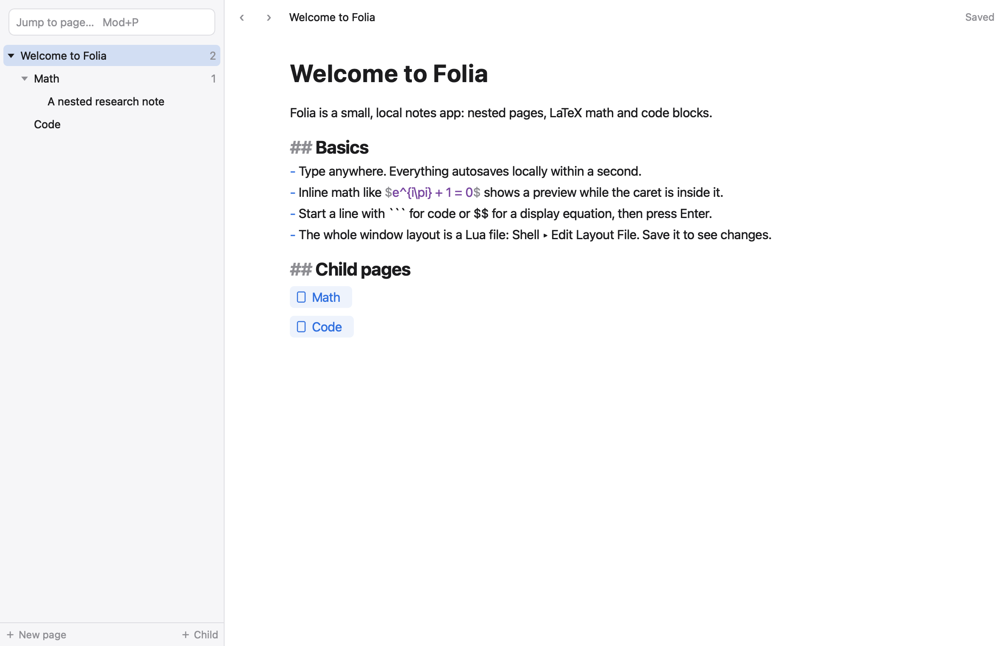
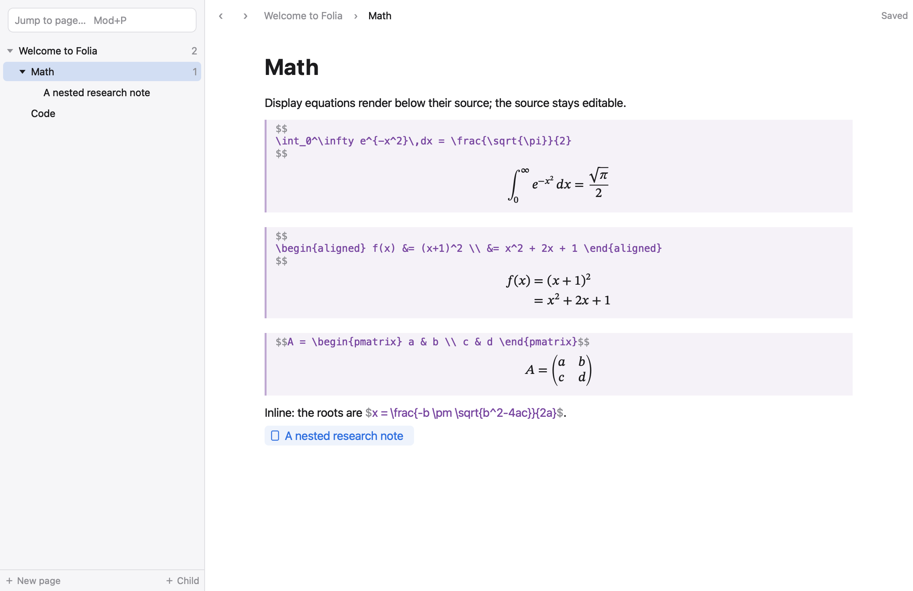
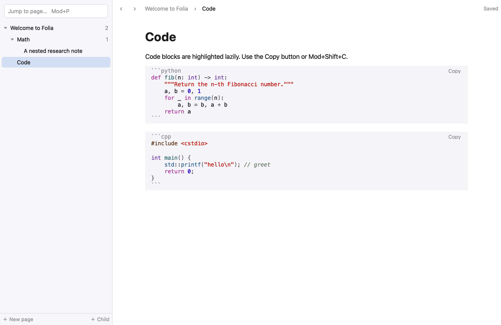
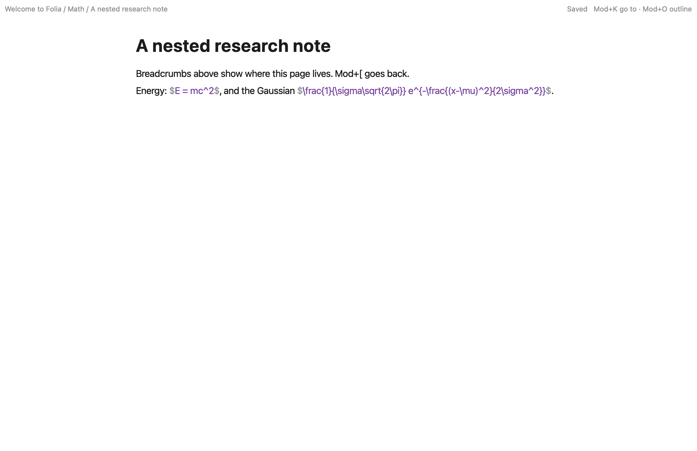

<p align="center"></p>

<p align="center">
  <strong>A fast, local notes app with nested pages, LaTeX math and code blocks.<br>
  Its whole window layout is a Lua file you can redesign without recompiling.</strong>
</p>

<p align="center">
  <a href="https://github.com/kenichist/folia/releases/latest"></a>
  <a href="https://github.com/kenichist/folia/actions/workflows/release.yml"></a>
  
  
</p>

<p align="center">
  <a href="#download"><b>Download</b></a> ·
  <a href="#features"><b>Features</b></a> ·
  <a href="#customize-the-layout"><b>Customize</b></a> ·
  <a href="#build-from-source"><b>Build from source</b></a> ·
  <a href="#documentation"><b>Docs</b></a>
</p>

<p align="center"></p>

## Why Folia

- **Local and private.** Your notes live in one SQLite file on your own disk. No account, no cloud, no telemetry.
- **Light.** Native Qt Widgets, no browser engine. About 50 MB at idle and a ~0.35 s launch on an M1 MacBook Air.
- **Made for technical notes.** LaTeX math renders as you type, and fenced code blocks are highlighted in 19 languages.
- **Yours to reshape.** The sidebar, toolbar and overlays are defined in a Lua layout file. Edit it, save it, and the window reloads live.

## Download

Get the latest version from the **[Releases page](https://github.com/kenichist/folia/releases/latest)**.

| Platform | Download | Requirements |
|---|---|---|
|  **macOS** | `Folia-<version>-macOS-universal.dmg` | macOS 12 or later, Apple silicon or Intel |
|  **Windows** | `Folia-<version>-windows-x64-setup.exe` (installer) or `…-windows-x64.zip` (portable) | Windows 10 or 11, x64 |
|  **Linux** | `Folia-<version>-linux-x86_64.AppImage` or `…-linux-x86_64.tar.gz` | x86_64, glibc 2.35+ (Ubuntu 22.04, Debian 12, Fedora 36 or newer) |

<details>
<summary><b>Installing and first launch</b></summary>

- **macOS**: open the DMG and drag **Folia** into **Applications**. The app is not notarized yet, so the first time, right-click it and choose **Open**, then **Open** again.
- **Windows**: run the installer. If SmartScreen appears, choose **More info** ▸ **Run anyway**. The zip needs no install: unzip it and run `Folia.exe`.
- **Linux**: `chmod +x Folia-*.AppImage` and run it. The tarball holds the same app unpacked; run `./AppRun` inside it.

Every release includes `SHA256SUMS.txt` to verify the downloads.
</details>

## Features

<table>
<tr>
<td width="50%" valign="top">

### 📄 Pages
Nested pages with breadcrumbs, child-page links, collapse and expand, move, reorder and indent, title jump (Mod+P) and back/forward. Hover a page in the sidebar to add a page inside it or delete it.

### ✍️ Editing
Native text editing with IME support, undo/redo and full keyboard navigation. Autosave commits within one second, and **Saved** appears only once your change is on disk.

### 🔗 Links
Bare URLs are clickable. Select text and press Mod+K, or paste an address onto a selection, to make a named link. Links are stored as plain Markdown.

### 🖼️ Images
Paste or drop an image into a page, or use **Edit ▸ Insert Image…**. Images are decoded only while near the screen, within a fixed memory budget.

### 📑 PDFs beside your notes
Paste or drop a PDF into a page, then click its card: it opens as a second tab next to the note, so you can read and write side by side. Drag the divider to resize (double-click for equal widths), swap sides with the ⇄ button or **View ▸ Swap Panes**, and close it with × or Esc. Side and width are remembered. The note stays open as you move between pages. The Windows and Linux builds don't display PDFs yet.

</td>
<td width="50%" valign="top">

### ∑ Math
A built-in TeX renderer ([supported subset](docs/MATH_SUBSET.md)). Display equations render below their source; inline `$…$` renders in place and shows its source when the caret touches it.

### `{ }` Code
Fenced code blocks with highlighting for [19 languages](docs/CODE_LANGUAGES.md), a Copy button and Mod+Shift+C.

### 🎨 Appearance
Light, Dark or Match System, an accent color, and your choice of text and code fonts, sizes, line height and text width.

</td>
</tr>
</table>

<p align="center">
  
  
</p>

## Customize the layout

Folia's window is described by a Lua file. Three layouts ship with the app:

| Layout | Description |
|---|---|
| `default` | Sidebar with the page tree, as in the screenshots above |
| `keyboard` | Keyboard-first: no sidebar, with picker and outline overlays |
| `examples/right-nav` | An example of a custom layout, with navigation on the right |

Choose **Shell ▸ Edit Layout File** to open the active layout in your editor; saving it reloads the window live. If a layout has an error, the last working layout stays and a banner explains the problem. **Shell ▸ Reset to Default Layout** (Mod+Alt+Shift+R) always gets you back. The full language is documented in [`presets/REFERENCE.md`](presets/REFERENCE.md).

<p align="center"></p>

## Settings

Open **Folia ▸ Settings…** on macOS or **File ▸ Settings…** on Windows and Linux (Mod+, or the gear at the bottom of the sidebar). Settings opens inside the main window; **‹ Notes**, Esc or Mod+W takes you back.

- **General**: reopen the last page at startup; where your data lives.
- **Appearance**: Light / Dark / Match System, accent color, text and code fonts and sizes.
- **Editor**: text width, line height, paragraph spacing, side margin; math rendering on or off.
- **Layout**: switch layouts, edit or reload the layout file, live reload, reset to default.

Changes apply immediately and are layered over the active layout's theme, so your Lua file is never rewritten.

## Your data

| Platform | Location |
|---|---|
| macOS | `~/Library/Application Support/Folia/Folia/` |
| Windows | `%APPDATA%\Folia\Folia\` |
| Linux | `~/.local/share/Folia/Folia/` |

The folder holds `workspace.db` (all your pages) and `shell/`, your editable copies of the layouts. Back up the folder to back up everything.

### Command-line options

| Option | Effect |
|---|---|
| `--preset keyboard` | Start with a different layout |
| `--shell file.lua` | Use a specific layout file |
| `--safe-mode` (or hold Shift at launch) | Use the built-in default layout |
| `--no-math` | Don't load the formula renderer |
| `--home dir` | Use a separate data folder |

## Performance

Measured on a MacBook Air M1 (8 GB) with a 50,000-page workspace:

| | |
|---|---|
| Launch to an editable page | 375–404 ms |
| Memory at idle | ~50 MB once the window has been still for 10 s (~80 MB while it repaints; an empty Qt window is 47 MB) |
| CPU at idle | 0.16–0.27% of one core |
| Typing | ~5 ms of CPU per keystroke |
| 500 page switches | memory plateaus at ~111 MB |

<details>
<summary><b>Full measurements and method</b></summary>

Latest valid run (`bench/results/m1-2026-11-04/`): MacBook Air M1 (8 GB),
macOS 26.6.2 (25G83), Release build, Qt 6.12.0, on battery with Low Power
Mode off, thermal state nominal unless noted. The window was 1180×765 pt at
2×, and the fixture was a 50,000-page workspace (seed 42). The "ordinary
page" has 100 blocks (about 25 KiB) with formulas and code. Counters cover
Folia's own process only, so WindowServer is not included; MB = 10⁶ bytes.
Runs disturbed by a covered window, a sleeping Mac or user input were rerun,
and the originals are set aside (`PROVENANCE.md`). These runs measure the
0.1.0 code; links, icons, in-place inline math and Settings came later and
were not re-run.

| Measure | Result | Counter | Date |
|---|---|---|---|
| Idle footprint, 60 s after a 5 s settle | median 80.2 MB with the default layout, 79.2 MB with keyboard, 76.0 MB with an editor-only layout and `--no-math`; 114.2 MB with the 10 MiB stress note open. Misses the 60 MB stretch target | `task_vm_info.phys_footprint`, 1 s samples | 2026-11-05 |
| Idle CPU, same runs | mean 0.16–0.27% of one core (7 runs; target < 1%) | `task_power_info` user + system time | 2026-11-05 |
| Idle wakeups, same runs | 5.2–5.7/s mean, 5/s median. Includes the bench driver's own 1 Hz sampler and 4 Hz window probe; app-only wakeups are not isolated | `task_power_info` interrupt + platform-idle wakeups | 2026-11-05 |
| Typing CPU, 1000 edits in 16.8 s on the ordinary page | 5.0–5.4 ms per edit, all threads (3 runs); 3.0 ms in a 1 MiB code block | `task_power_info` user + system ÷ edits | 2026-11-04 |
| Typing wakeups, same runs | 18–37 per run; interrupt wakeups are not isolated | `task_platform_idle_wakeups` | 2026-11-04 |
| Peak footprint | 118.9–119.1 MB over a typing run (launch, open, 1000 edits); 214 MB in the 10 MiB stress-note test (open, jump to end and back, select all, copy) | `task_vm_info.ledger_phys_footprint_peak` | 2026-11-04 |
| Launch → editable ordinary page | 375–404 ms (4 warm launches); 1406 ms for the first launch after a rebuild. Footprint 2 s later: 80.0–80.5 MB | kernel process start (`p_starttime`) to end of the first editor paint; `phys_footprint` | 2026-11-05 |
| 500 page switches in 5 batches of 100 | footprint after each batch: 107.2 → 110.0 → 110.5 → 110.6 → 110.7 MB, a plateau; document cache 3.7 MB of its 48 MiB cap. Thermal state fair | `phys_footprint` after settling | 2026-11-04 |

Settings (`--bench settings`): nothing while closed; first open about 80 ms,
reopening 36 ms; +3.5 MB while open and +6.6 MB kept after the first open,
with no growth over 30 opens; a text-size change takes under 1 ms of
main-thread work (~32 ms to the screen), a light/dark switch about 17–21 ms
(~48 ms to the screen).

Windows and Linux hardware are not benchmarked yet. See
[`docs/RELEASE_REPORT.md`](docs/RELEASE_REPORT.md),
[`docs/BENCHMARKS.md`](docs/BENCHMARKS.md) and
[`bench/results/m1-2026-11-04/REPORT.md`](bench/results/m1-2026-11-04/REPORT.md).
</details>

## Build from source

Folia is C++17 with Qt 6 Widgets (6.5 or later), embedded Lua 5.5 and SQLite 3.54; Lua and SQLite are vendored in `third_party/`.

**macOS**

```sh
brew install cmake ninja qtbase
cmake -S . -B build -G Ninja -DCMAKE_BUILD_TYPE=Release -DCMAKE_PREFIX_PATH=/opt/homebrew/opt/qtbase
cmake --build build
open build/src/Folia.app
ctest --test-dir build --output-on-failure
sh packaging/macos/package.sh       # self-contained dist/Folia.app + dist/Folia.dmg
```

**Linux and Windows**: see [`packaging/linux/README.md`](packaging/linux/README.md) and [`packaging/windows/README.md`](packaging/windows/README.md).

Release packages for all three platforms are built and tested by the [Release workflow](.github/workflows/release.yml). Pushing a `v*` tag publishes a GitHub release with the packages attached.

## Documentation

| Document | Contents |
|---|---|
| [`docs/ARCHITECTURE.md`](docs/ARCHITECTURE.md) | Interfaces, identities and revisions, durability, threads, caches |
| [`presets/REFERENCE.md`](presets/REFERENCE.md) | Layout (shell) language reference |
| [`docs/MATH_SUBSET.md`](docs/MATH_SUBSET.md) | Supported TeX commands |
| [`docs/CODE_LANGUAGES.md`](docs/CODE_LANGUAGES.md) | Highlighted code languages |
| [`docs/BENCHMARKS.md`](docs/BENCHMARKS.md) | Fixtures and benchmark harness |
| [`docs/RELEASE_REPORT.md`](docs/RELEASE_REPORT.md) | Results, achieved and missed targets |
| [`packaging/brand/`](packaging/brand/) | App icon and banner, drawn from hand-placed vertices (`swift packaging/brand/make_brand.swift` regenerates them) |

## Contributing

Bug reports and feature ideas are welcome on the [issue tracker](https://github.com/kenichist/folia/issues). For code changes, open a pull request; please run `ctest` before submitting.

## Acknowledgements

Folia is built with [Qt](https://www.qt.io), [Lua](https://www.lua.org) and [SQLite](https://sqlite.org). Icons are from [Lucide](https://lucide.dev).
