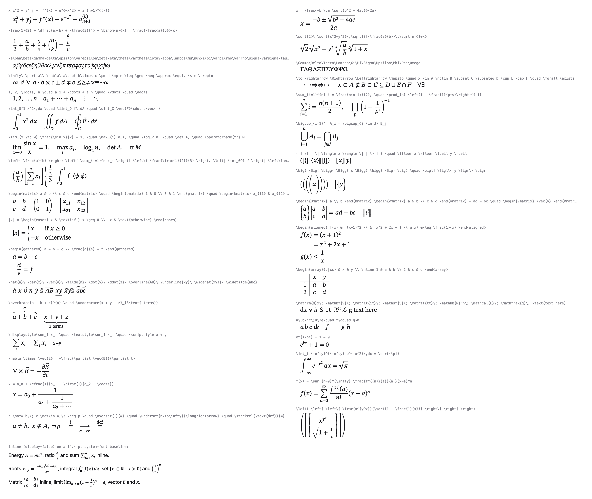

# Folia math: declared LaTeX subset

Folia renders math natively: there is no browser engine and no external
process. `folia::math::render()` (`src/math/MathRenderer.h`) parses a TeX
subset and lays it out with TeX's rules (TeXbook Appendix G), using the
font's OpenType `MATH` table the way MathML Core does. The result is a
resolution-independent `MathDisplayList` (glyph runs, rules and filled paths)
positioned relative to the baseline. The editor paints it with
`MathDisplayList::paint()`.



*`docs/img/math-gallery.png`: the test corpus in display style, plus inline
formulas on a 14.4 pt system-font baseline. Rendered by `math_gallery` at 2×
device pixel ratio.*

## Layout model

* **Atom classes**: ord, op, bin, rel, open, close, punct and inner. Spacing
  between atoms follows TeX's table: thin = 3mu, medium = 4mu, thick = 5mu,
  where 1mu = 1/18 em of the current style. Entries in parentheses in TeX's
  table are dropped in script styles. A binary operator becomes ord at the
  start of a list, or after bin, op, rel, open or punct; and when it is
  followed by rel, close or punct. So `-x` is unary and `a-x` is binary.
* **Styles**: display, text, script and scriptscript, each with a cramped
  variant. The script sizes come from the font: STIX Two Math uses 70 % and
  55 %. Fractions, scripts, radicals, accents and limits use TeX's style
  transitions.
  * `Style.display = true` starts in display style.
  * `false` starts in text style: inline fractions use script-size parts,
    and `\sum` puts its limits on the right.
* **Inline baseline**: y = 0 is the baseline of the surrounding text, +y
  points down, and `ascent`/`descent` are ≥ 0 and include all ink. An inline
  formula therefore sits on the text baseline when it is drawn at
  `(x, baselineY)`.
* **Units**: display-list coordinates are logical pixels.
  * The em equals `Style.pointSize` × (default font DPI / 72), rounded to a
    whole pixel. That is exactly the size Qt uses when it draws a `QFont` of
    that point size, so formulas match the text around them. On macOS
    1 pt = 1 px.
  * Every style size is rounded to a whole pixel because Qt font engines
    only exist at integer pixel sizes.
  * Fonts in the list are pixel-sized, so painting doesn't depend on the
    target device's DPI.
* **Stretchy glyphs**: delimiters, radicals and display operators use the
  font's size variants, then glyph assemblies (top / extender / middle /
  bottom), all drawn as outlines. Wide accents and braces use the
  horizontal constructions. If a font has no construction for a character
  (or no MATH table at all), Folia draws synthetic scalable `QPainterPath`
  shapes for these characters: ( ) [ ] { } | ‖ ⟨ ⟩ ⌊ ⌋ ⌈ ⌉ ⟦ ⟧ / \ √ ⏞ ⏟ ⏜ ⏝ ⎴ ⎵.

## Compatibility

Legend: **✓** supported · **◐** partial (see note) · **✗** unsupported (an
unknown command gives the error `Unknown command \foo`).

| Construct | Status | Notes / example |
|---|---|---|
| Letters, digits, operators | ✓ | Letters are italic (Unicode math italic, `h` → ℎ). Digits and operators are upright; `-` becomes − (U+2212) and `*` becomes ∗. |
| Primes `x'`, `f''` | ✓ | Drawn as ′ ″ ‴ ⁗ after the nucleus; a subscript goes underneath (`y'_j`). |
| Sub/superscripts | ✓ | `x_i^2`, `x^2_i`, nested `e^{-x^2}`, `a_{n+1}^{(k)}`, `{}^{14}C`. Double scripts are errors. |
| `\frac \dfrac \tfrac \cfrac` | ✓ | Single-token arguments work (`\frac12`). TeX's infix `{a \over b}`, `\atop` and `\choose` also work. |
| `\binom \dbinom \tbinom` | ✓ | Uses the stack constants plus stretchy parentheses. |
| `\sqrt{x}`, `\sqrt[n]{x}` | ✓ | Radical variants and assembly; the index sits in scriptscript style. |
| Greek letters | ✓ | All lowercase letters and `var` forms (`\varepsilon \vartheta \varpi \varrho \varsigma \varphi \varkappa`) are italic. Uppercase is upright (`\Gamma … \Omega`, plus `\Alpha` etc.). |
| Symbols | ✓ | `\infty \partial \nabla \forall \exists \nexists \emptyset \varnothing \neg \top \bot \angle \hbar \ell \wp \Re \Im \aleph \prime …` |
| Binary operators | ✓ | `\pm \mp \times \div \cdot \ast \star \circ \bullet \oplus \ominus \otimes \oslash \odot \cup \cap \sqcup \sqcap \vee \wedge \setminus \wr \diamond \uplus \amalg \dagger \ddagger \ltimes \rtimes \boxplus …` |
| Relations | ✓ | `= < > : \leq \geq \neq \approx \equiv \sim \simeq \cong \propto \ll \gg \prec \succ \preceq \succeq \subset \supset \subseteq \supseteq \subsetneq \in \notin \ni \mid \nmid \parallel \perp \vdash \models \asymp \doteq \coloneqq \leqslant \lesssim …` |
| Arrows | ✓ | `\to \rightarrow \leftarrow \gets \leftrightarrow \Rightarrow \Leftarrow \Leftrightarrow \mapsto \longmapsto \longrightarrow \Longrightarrow \implies \iff \hookrightarrow \uparrow \Downarrow \nearrow \rightleftharpoons \leadsto …` |
| Dots | ✓ | `\ldots \cdots \vdots \ddots \dots \dotsc \dotsb`; `\ldots`, `\cdots` and `\ddots` are inner atoms. |
| Negation `\not` | ✓ | Uses precomposed glyphs where they exist (`\not=` → ≠, `\not\in` → ∉, `\not\subset` → ⊄ …), otherwise an overlaid slash. |
| Big operators | ✓ | `\sum \prod \coprod \bigcup \bigcap \bigvee \bigwedge \bigoplus \bigotimes \bigodot \biguplus \bigsqcup` use the display-size variant and put limits above/below in display style. |
| Integrals | ✓ | `\int \iint \iiint \oint \oiint \oiiint`: large variant in display style, scripts to the right (the subscript is tucked in by the italic correction). |
| `\limits \nolimits \displaylimits` | ✓ | `\int\limits_0^1`, `\sum\nolimits_i`. |
| Function names | ✓ | `\sin \cos \tan \cot \sec \csc \arcsin \arccos \arctan \sinh \cosh \tanh \coth \log \ln \lg \exp \arg \deg \dim \hom \ker \sgn \tr`. These are limit-taking in display: `\lim \liminf \limsup \max \min \sup \inf \det \gcd \Pr`. |
| `\operatorname{…}`, `\operatorname*{…}` | ✓ | Upright text with operator spacing; the starred form takes limits. Also `\mathop{…}`. |
| Delimiters | ✓ | `( ) [ ] \{ \} \lbrace \rbrace \lbrack \rbrack \| \vert \Vert \lvert \rvert \lVert \rVert \langle \rangle \lfloor \rfloor \lceil \rceil \llbracket \rrbracket` |
| `\left … \middle … \right` | ✓ | Stretchy; uses TeX's sizing rule (delimiter factor 901, shortfall 0.5 em). `\left.` and `\right.` are null delimiters. Also `/ \backslash \uparrow \downarrow \updownarrow \Uparrow \Downarrow \Updownarrow` and `< >` as angles. |
| `\big \Big \bigg \Bigg` (+`l`/`r`/`m`) | ✓ | 1.2 / 1.8 / 2.4 / 3.0 em tall; the `l`/`r`/`m` suffix sets the open/close/rel class. |
| `matrix pmatrix bmatrix Bmatrix vmatrix Vmatrix` | ✓ | Text-style cells, centred columns, 1 em column gap. |
| `smallmatrix` | ✓ | Script-style cells. |
| `cases`, `dcases`, `rcases` | ✓ | Left-aligned columns with a 1 em gap; `\arraystretch` 1.2. |
| `aligned`, `gathered` | ✓ | Display-style rows with 0.3 em `\jot`. `aligned` uses rl column pairs, and `&=` keeps relation spacing. |
| `align`, `align*`, `split`, `alignat`, `gather`, `gather*`, `equation`, `equation*` | ◐ | Aliases of `aligned`/`gathered`: no equation numbers, and the `alignat{n}` argument is ignored. |
| `array{…}` | ✓ | `l c r` columns, `\|` vertical rules (doubled `\|\|` works), `\hline`. `@{}`, `p{}` and other column types are an error that points at the offending character. |
| `&`, `\\`, `\\[1ex]` | ✓ | A trailing `\\` is ignored. A top-level `\\` (with optional `&`) acts as implicit `gathered`/`aligned`. |
| Accents | ✓ | `\hat \bar \vec \tilde \dot \ddot \dddot \check \breve \acute \grave \mathring` use the font's top-accent attachment for single letters. |
| Wide accents | ✓ | `\widehat \widetilde \widecheck \overrightarrow \overleftarrow \overleftrightarrow` are horizontally stretchy. |
| `\overline \underline` | ✓ | Rules placed with the MATH overbar/underbar constants. |
| `\overbrace{…}^{…} \underbrace{…}_{…}` | ✓ | Also `\overparen \underparen \overbracket \underbracket`; the annotation is stacked like limits. |
| `\overset \underset \stackrel` | ✓ | Class comes from the base (`\stackrel` gives rel). |
| `\mathrm \mathbf \mathit \mathsf \mathtt \mathbb \mathcal \mathscr \mathfrak \boldsymbol \bm` | ✓ | Mapped to Unicode Mathematical Alphanumeric Symbols (with Letterlike exceptions such as ℝ ℂ ℒ). If the font lacks them, falls back to the plain letter in italic/bold/sans/mono. |
| `\rm \bf \it \sf \tt \cal` | ✓ | Old-style switches, scoped to the group. |
| `\text \textrm \textbf \textit \texttt \textsf \mbox \emph` | ✓ | Text font, spaces kept, escapes `\{ \} \$ \% \& \# \_ \ `. Commands or `$…$` inside text are errors; limit 2000 characters. |
| Spacing | ✓ | `\, \: \> \; \! \quad \qquad ~ \ \enspace \thinspace \medspace \thickspace \negthinspace …`; `\hspace{…} \kern \mkern \mskip` accept units em, ex, mu, pt (relative to a 10 pt design size), px, mm, cm, in. Values are capped at ±50 em. |
| `\displaystyle \textstyle \scriptstyle \scriptscriptstyle` | ✓ | Applies to the rest of the group. |
| `\phantom \hphantom \vphantom \smash \boxed` | ✓ | |
| `\mathord \mathbin \mathrel \mathopen \mathclose \mathpunct \mathinner` | ✓ | Class overrides. |
| `\pmod \pod \mod \bmod` | ✓ | |
| Unicode input (α ≤ ∑ …) | ✓ | Classified like the matching command; Greek letters follow the alphabet rules. |
| `%` comments | ✓ | |
| `\color`, `\textcolor` | ◐ | Parsed but the colour is ignored, because the display list paints in one colour. The content still renders. |
| Macros (`\newcommand`, `\def`), `\tag`, `\label`, `\xrightarrow`, `\substack`, `\genfrac`, `\sideset`, `\cancel`, `\rule`, `\raisebox`, `\href` | ✗ | Error "Unknown command". |
| Line breaking of long formulas | ✗ | A formula is one box; the editor scrolls or clips. |

## Limits (`math::Limits`)

| Field | Default | Behaviour |
|---|---|---|
| `maxSourceChars` | 8192 | Checked first. Error `Formula too long (N characters; limit M)`, `errorOffset = M`. |
| `maxDepth` | 48 | Group, argument, environment and `\left` nesting. Clamped internally to [1, 100] so recursion stays far below a 512 KiB worker-thread stack. Error `Formula nested too deeply (limit N)` at the token that went too deep. |
| `maxNodes` | 6000 | AST nodes (atoms, groups, cells…). Error `Formula too complex (more than N nodes)`. |
| `maxMillis` | 40 | Wall clock per formula, checked once per atom in both parser and layout (QElapsedTimer). Error `render time limit exceeded (N ms)`, offset −1. The one-time font initialisation is not charged. Time spent on a process's first-ever measurement of a glyph (Qt font fallback lookups) is credited, up to 250 ms per render. |
| `cancel` | — | Polled at the same points. Returns `ok=false, error="cancelled"`; measured latency is about 1 ms. |

A non-positive limit falls back to its default. Internal hard caps:

* `\text` up to 2000 characters
* explicit dimensions up to ±50 em
* rendered width and height up to 4000 em (`Formula too large to display`)
* at most 400k layout items
* the glyph-metrics cache holds at most 20 000 entries, and only strings of 24 characters or fewer are cached

Delimiter assemblies stretch a single extender per gap, so their item count
is O(1) regardless of height.

## Errors

`render()` never throws. On error it returns `ok=false`, a human-readable
`error`, and `errorOffset`, a QChar offset into the source (−1 for
deadline/cancel). The list is empty, so the editor keeps the source editable
and shows the message. Offsets point at the cause:

| Input | Offset points at | Message |
|---|---|---|
| `x + {a + b` | the unmatched `{` | Missing closing brace '}' |
| `a + b}` | the `}` | Unexpected '}' (no matching '{') |
| `x + \foo{y}` | the `\` of `\foo` | Unknown command \foo |
| `a + \left( b` | `\left` | \left without matching \right |
| `a \right)` | `\right` | \right without matching \left |
| `\left x` | the bad token | Missing or unsupported delimiter after \left |
| `\begin{matrix} a \end{pmatrix}` | `\end` | \end{pmatrix} does not match \begin{matrix} |
| `x \begin{cases} a` | `\begin` | Missing \end{cases} |
| `\begin{foo}` | `foo` | Unknown environment 'foo' |
| `x^1^2` | second `^` | Double superscript (use braces, e.g. x^{ab}) |
| `\frac{a}` | `\frac` | Missing argument for \frac |
| `{a & b}` | `&` | Misplaced '&' (only allowed in matrix-like environments) |
| `\begin{array}{cx}` | `x` | Unsupported array column type 'x' (use l, c, r, \|) |
| `x\limits` | `\limits` | \limits must follow a math operator |

## Fonts

All fonts are resolved once, lazily, on first use. The resolution is
thread-safe: it runs under a mutex and is published through an atomic
pointer. Families are matched by name against `QFontDatabase::families()`,
taking the first one present:

* **Math**: `$FOLIA_MATH_FONT` (debug override, used only if that family is
  installed) → STIX Two Math → Cambria Math → Latin Modern Math → XITS Math
  → STIX Math (STIX 1.1, Debian `fonts-stix`) → TeX Gyre Termes Math →
  Libertinus Math → STIX Two Text → STIXGeneral → serif (Times New Roman,
  Times, Georgia, DejaVu Serif, Liberation Serif, Noto Serif, Cambria) →
  system font. Fonts that have a MATH table are deliberately tried before
  STIX Two Text.
* **Text** (`\text`): STIX Two Text → Cambria → Latin Modern Roman →
  STIXGeneral → Times New Roman → Times → Georgia → DejaVu Serif →
  Liberation Serif → the math family.
* **Sans / mono**: only used when the math font lacks math alphanumerics.
  Sans: Helvetica Neue, Helvetica, Arial, Segoe UI, DejaVu Sans… Mono: Menlo,
  Monaco, Consolas, DejaVu Sans Mono…

Resolved families on the tested systems:

| System | Math family | Notes |
|---|---|---|
| This Mac | STIX Two Math | MATH table v1.0; 375 outlines cached; 46 vertical and 16 horizontal constructions. Text family: STIX Two Text. |
| Debian 13 with fonts-stix | STIX Math | 258 outlines. |
| Debian 13 with only fonts-dejavu-core / fonts-noto-cjk | DejaVu Serif | Partial MATH table, see below; 81 outlines. |

The one-time build reads the MATH table through a `QRawFont` created and
destroyed on the calling thread:

* the constants
* italic corrections and top-accent attachments for all letters
* variants and assemblies for every stretchy character
* the outlines those need

Afterwards everything is immutable plain data. Glyph metrics are measured once per (font variant, string) at a 100 px
reference size and kept in a process-wide cache behind a `shared_mutex`:

* **Advance**: `QFontMetricsF::horizontalAdvance`.
* **Ink box**: taken from the exact glyph outline (`QPainterPath::addText`,
  which includes Qt's font fallback). Engine glyph boxes are not exact:
  CoreText's `tightBoundingRect` pads right/bottom by up to 1 px, and
  FreeType rounds glyph boxes to whole pixels.
* **Multi-character strings** (`\text`, function names): composed from the
  cached single-character boxes. A 2000-character `\text` therefore costs
  about 0.5 ms rather than 130 ms of outline extraction.
* **Coverage**: checked with `inFontUcs4`; a missing glyph falls back to
  Qt's font merging.

**Partial MATH tables.** Every MATH constant that is missing or nonsensical
(≤ 0, or larger than 3 em) is replaced by its TeX-derived default. If two
or more core shifts are missing (sub/superscript shifts, fraction and limit
gaps, rule thicknesses), the whole table is distrusted. Debian's DejaVu
Serif is such a table: it leaves sub/superscript and limit shifts at 0 and
sets `SuperscriptBottomMin` to the x-height. In that case only axis height
and accent base heights are kept from the font; the glyph constructions are
still used.

**Large operators** are normalised to the OpenType convention, where the
advance covers the ink and the italic correction tucks the subscript in.
STIX 1.1's integrals instead have ink overhanging a narrow advance and no
italic correction. For such fonts the box is widened to the ink and the
overhang is used as the italic correction, so limits clear the hook. A
display-style operator without size variants is drawn at 1.4×.

Without a MATH table (try `FOLIA_MATH_FONT=Georgia`), layout uses TeX-derived
default constants:

* display operators are drawn at 1.4×
* delimiters and radicals are synthetic paths
* accents use spacing glyphs

## Thread safety

* `render()` and `resolvedFontFamily()` may be called from any thread
  concurrently. Each call builds its own `QFont` objects; nothing shared is
  mutated except the mutex-guarded metrics cache.
* **Box vs pixels**: the reported box contains the exact outlines of
  everything drawn (tested to 0.1 px). Painted pixels with visible coverage
  stay within the box grown by 0.5 px (Qt snaps text baselines and glyph
  positions to the pixel grid) and rounded out to whole pixels (the
  antialiased pixel straddling each edge). When you allocate an image or
  clip rect for a formula, add a 1 px margin on each side. CoreText's
  font-smoothing halo below 3 % coverage can reach one pixel further.
* `paint()` belongs on the GUI thread. A given `MathDisplayList` must not be
  painted from two threads at the same time, because the `QFont`s inside
  are reentrant but not thread-safe. Reading its geometry (`width`,
  `ascent`, …) from any thread is fine.
* A `QGuiApplication` must exist. Without one, `render()` returns
  `ok=false` ("Math fonts unavailable") instead of touching the font
  database.
* The first call pays the font build (about 5 ms here) while holding the
  init mutex. Warm up from a worker (`math::resolvedFontFamily()`) at
  startup if the GUI thread could be the first caller.

Verified by:

* `math_tests::concurrency`: 4 `QThreadPool` threads render the corpus in
  different orders, with cold glyphs; the results are bit-identical to
  single-threaded renders.
* `math_init_race`: 8 threads make the first calls of a fresh process.
* ThreadSanitizer: both tests, and the whole of `math_tests`, run with no
  reports.
* ASan + UBSan: `math_tests`, `math_init_race` and the Georgia-fallback
  gallery are clean.

## Measured timings

These numbers are raw output from `math_tests` (`perf`/`initTestCase`).

* **Machine**: Apple M1 MacBook Air, 8 GB, macOS 26.6.2.
* **Toolchain**: Qt 6.12.0 (Homebrew qtbase), Apple clang 21, Release build
  (`-O3`).
* **Load**: the machine was shared with parallel builds (load average about
  15) during these five runs. One earlier, quieter run measured
  p50 9.5 µs / p95 17.8 µs / p99 23.1 µs.

| Metric | Value (macOS runs) |
|---|---|
| Per-formula render: 34-formula corpus × 12 passes = 408 renders, 14 pt, alternating display/inline, warm metrics cache | **p50 11.0–12.4 µs, p95 22.4–23.8 µs, p99 30.4–39.8 µs**; mean 12.3–13.2 µs, max 34–126 µs (6 runs) |
| First load: `QFontDatabase::families()` (platform font DB; any first text use pays this) | 63–71 ms |
| First load: `resolvedFontFamily()` (FontData build: families, MATH table, 375 outlines) | 4.7–5.6 ms |
| First render with a cold glyph cache (`x^2 + \frac{a}{b}`) | 0.34–0.80 ms |
| Same formula again | 5–6 µs |
| `paint()` into a 2× QImage on the GUI thread (includes first-time glyph rasterisation) | p50 73–80 µs, p95 442–494 µs, p99 0.68–1.18 ms |
| `byteSize()` of corpus display lists | mean 3120 bytes |
| Pathological inputs (see `math_tests::pathological`) | default limits: all < 1.2 ms; relaxed limits: all < 15 ms (worst about 13 ms, 100k-char flat formula, parse-bound) |
| Memory | FontData +2.6 MB RSS one-time; first renders +1.3 MB (per-size engines and glyph caches) |
| Linux, Debian 13 aarch64 container on the same Mac (Qt 6.8, GCC, offscreen), DejaVu Serif fallback | render p50 16.7–17.4 µs, p95 33–60 µs, p99 43–106 µs; resolve 3.4–4.3 ms; cold first render 1.2 ms |
| Linux, same container with fonts-stix (STIX Math) | render p50 15.3–15.5 µs, p95 30–41 µs, p99 40–70 µs; resolve 4.2–6.1 ms; cold first render 0.8–1.1 ms |
| Code size (`size libfolia_math.a`) | `__TEXT` 157 497 B, `__DATA` 8 000 B across 6 objects |

## Known gaps

* **Glyph-level refinements**:
  * No OpenType `ssty` script-style glyph variants: scripts are the base
    glyphs at the smaller size.
  * No `MathKernInfo` cut-ins: script placement uses italic correction and
    TeX's shifts only.
  * `\mathcal` uses the font's Unicode script letters (STIX's are swashier
    than Computer Modern's calligraphic).
  * Primes are drawn at base size after the nucleus instead of as
    superscript prime variants.
* **Wide accents**: on multi-letter italic groups they are centred on the
  advance box with no slant compensation, as in TeX. Single letters use the
  font's attachment points.
* **Infix/`\big` sizes**: TeX's infix `\over` family is supported, but
  `\above` and `\genfrac` are not. The `\big` sizes are fixed em heights
  rather than font-specific.
* **Unsupported commands**: no macros, colour (ignored), equation numbers
  or tags, `\substack`, `\xrightarrow`, `\cancel`, `\sideset`, or array
  column types beyond `l c r |`.
* **Single line**: a formula is a single box, with no automatic line
  breaking.
* **Fallback fonts** (no MATH table, or a partial one like DejaVu Serif):
  spacing and constants are TeX defaults; output is legible but less
  polished than with STIX Two Math or Cambria Math. These are covered by
  the Linux runs below and by `FOLIA_MATH_FONT=Georgia` on macOS.

## Tests and tools

```
cmake -S . -B build-math -G Ninja -DCMAKE_PREFIX_PATH=/opt/homebrew/opt/qtbase
cmake --build build-math --target folia_math math_tests math_gallery math_init_race
ctest --test-dir build-math -R math_ --output-on-failure
./build-math/tests/math/math_tests perf                     # perf report only
./build-math/tests/math/math_gallery [out.png] [--boxes] [--only substr] \
    [--pt 18] [--cols 2] [--scale 2] [--tex '<formula>' ...]
```

`--boxes` draws each formula's `width × (ascent + descent)` box and its
baseline. That helps check metrics and inline alignment.

**Platforms tested**: all suites pass 203/203 on each of these, and
`math_init_race` passes too.

* macOS 26.6.2 (STIX Two Math)
* Debian 13 aarch64 with Qt 6.8 and only DejaVu/Noto fonts (DejaVu Serif)
* the same container with `fonts-stix` (STIX Math)
